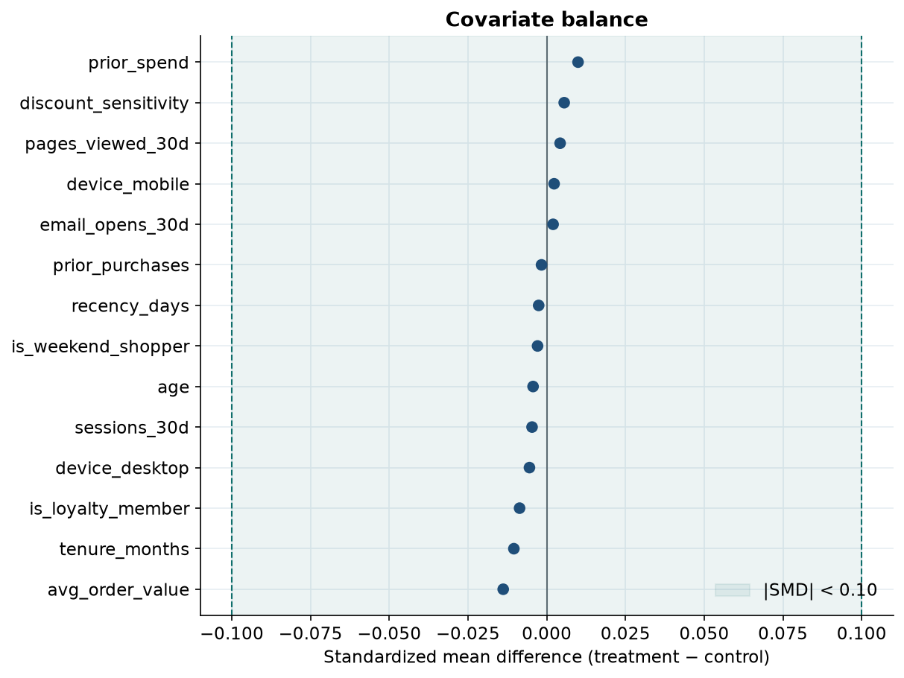
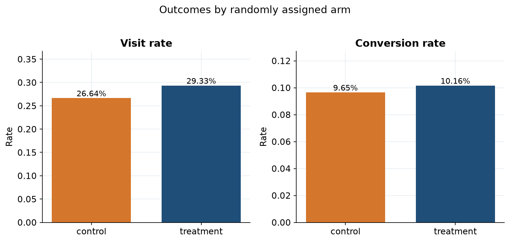
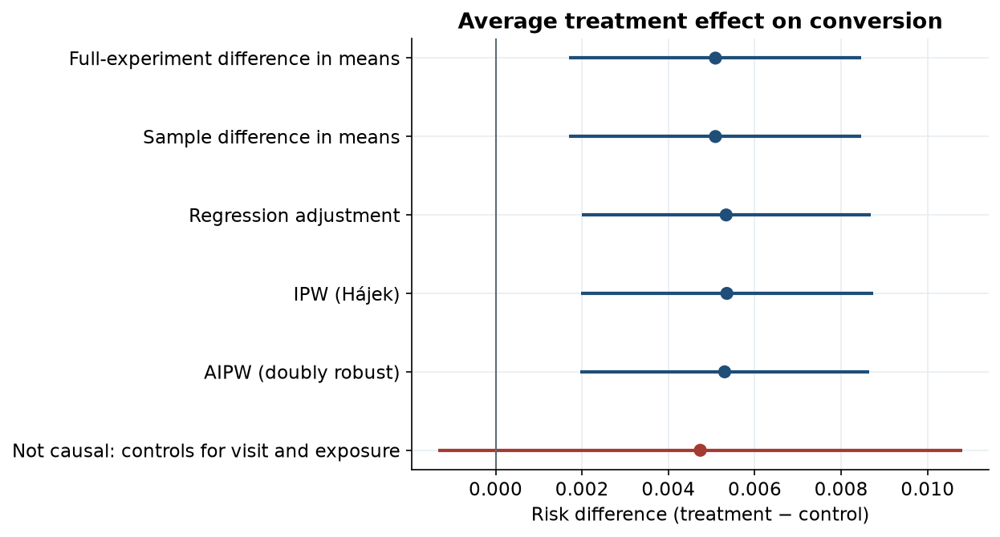
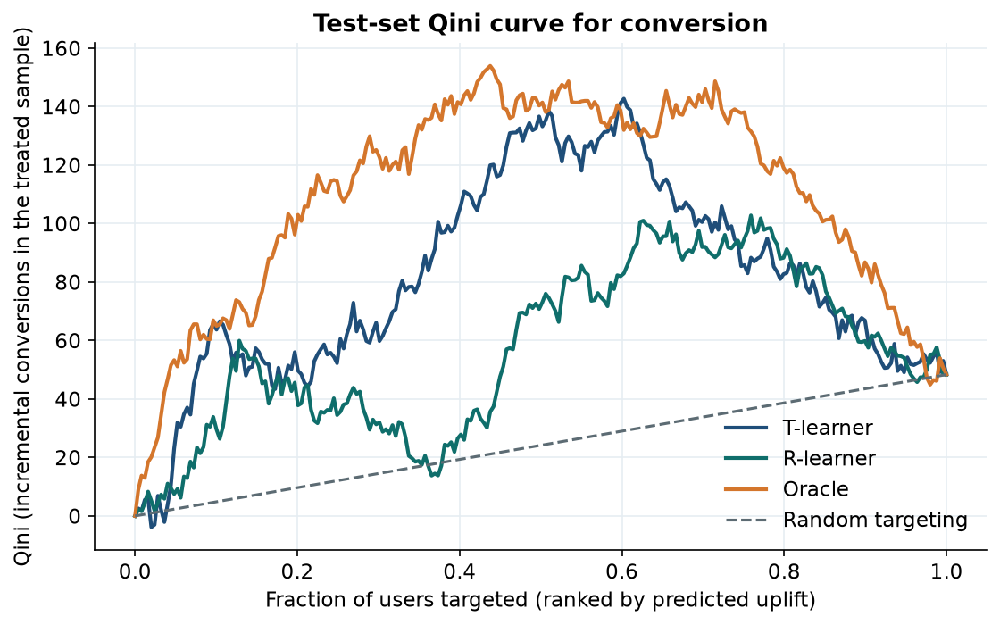
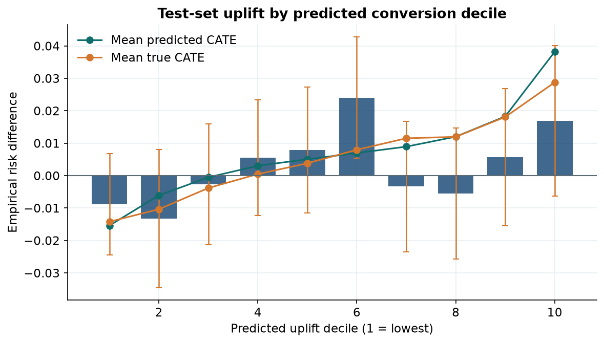
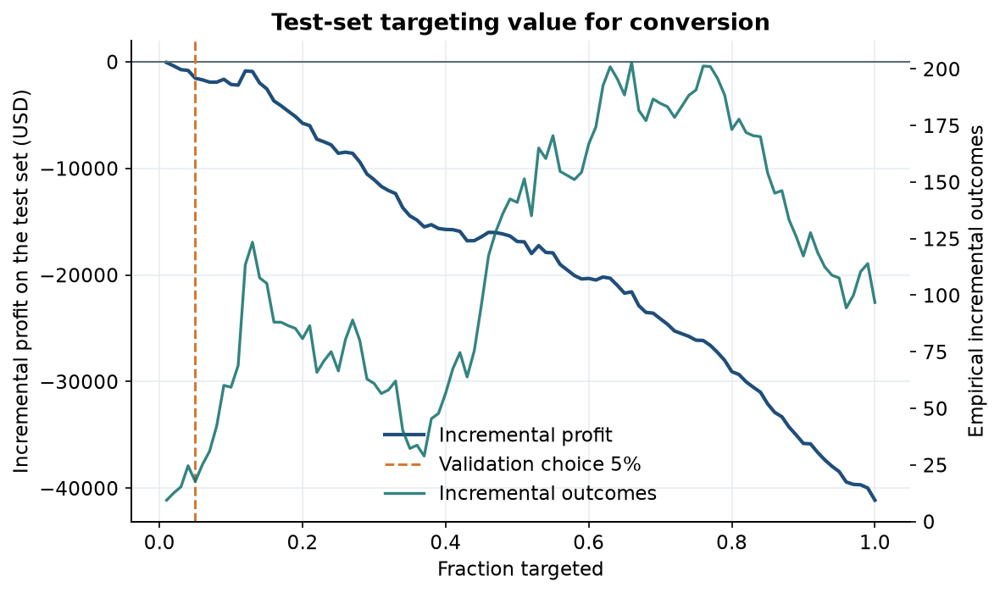

# Causal Analysis & Uplift Modeling for Marketing Campaign Targeting

A randomized promotion was assigned to half of 120,000 customers. The average conversion lift is real: **+0.51 percentage points** (9.65% in control, 10.16% in treatment; 95% CI 0.17 to 0.85; p = 0.0032). It is also too small to pay for the offer. At a pre-specified cost of **$1.25 per contact** and **$40 per incremental conversion**, treating everyone needs a conversion to be worth **$246** before the average effect breaks even. Ranking users by predicted uplift does not close that gap. On the locked test set, every targeting fraction loses money, and the least-bad slice still loses **$73**. The decision is not to launch this offer.

Average lift answers whether the campaign moved conversion. It does not answer who should receive the next dollar. Users differ: some are recent and engaged, some are already loyal, and some respond only to discounts. A single treatment effect averages those people together and will spend the budget on customers the offer does not move.

## Dataset

The intended source was the public [Criteo Uplift Prediction Dataset](https://ailab.criteo.com/criteo-uplift-prediction-dataset/) (v2.1). The file was reachable, the transfer stalled near 250 MB of 297 MB, and the host rejected resume requests. The analysis does not use that partial file.

The results below are from a seeded simulation, `src/data/synthetic.py`, written so the individual treatment effect is known and can be checked. It is a randomized experiment, not an observational study and not a Criteo analysis.

| | |
| --- | --- |
| Users | 120,000 |
| Assignment | Bernoulli(0.5); 59,943 treated, 60,057 control |
| Primary outcome | Binary conversion |
| Secondary outcome | Binary visit |
| Pre-treatment features | Age, tenure, prior purchases and spend, recency, sessions, email opens, pages viewed, average order value, discount sensitivity, loyalty, weekend shopping, device |
| Held out of every model | `exposure` (only possible after treatment), `visit` when conversion is the outcome, and the stored true effects |

`exposure` is 82.1% in the treatment arm and 0% in control. It is a post-treatment variable. A regression that controls for it is reported only as a biased specification.

The conversion effect was specified before any model was fit. It is larger for recent, engaged, newer customers who are not already loyal, and negative for disengaged discount-seekers ("sleeping dogs"). Both potential outcomes are clipped to (0.001, 0.95). The random seed is 42.

## Experiment analysis

Assignment is balanced enough for the unadjusted difference to be the causal benchmark. The largest absolute standardized mean difference on a pre-treatment covariate is **0.014**, under the 0.10 rule of thumb. There are no missing values, no duplicate row ids, and no invalid treatment or outcome codes.



Intent-to-treat results on the full experiment:

| | Conversion | Visit |
| --- | ---: | ---: |
| Treatment rate | 10.160% | 29.335% |
| Control rate | 9.651% | 26.640% |
| Absolute lift | +0.509 pp | +2.695 pp |
| 95% CI | 0.171 to 0.847 pp | 2.187 to 3.203 pp |
| Relative lift | 5.3% | 10.1% |
| Risk ratio | 1.053 (1.017 to 1.089) | |
| Two-proportion z | 2.95, p = 0.0032 | 10.40, p = 2.6×10⁻²⁵ |
| Chi-square | 8.70, p = 0.0032 | |



Achieved power for the observed conversion lift is **0.84**. The minimum detectable conversion effect at 80% power, given these arm sizes and the control rate, is **0.48 percentage points**. A 0.50 point lift would have needed about 112,000 users in total; the experiment has 120,000. Cohen's *h* is 0.017. Statistical significance here means the lift is distinguishable from zero, not that it is large enough to fund.

The same assignment raises visits by 2.7 points. A visit is not a conversion, and under the visit value assumed below it does not pay for the contact either.

## Causal estimation

Four estimators of the average treatment effect, plus one specification that is not causal:

| Estimator | Conversion | 95% CI |
| --- | ---: | --- |
| Full-experiment difference in means | 0.509 pp | 0.171 to 0.847 |
| Row-level difference in means | 0.509 pp | 0.171 to 0.847 |
| Regression adjustment (linear probability, HC1) | 0.534 pp | 0.199 to 0.868 |
| IPW (Hájek, propensity clipped to [0.01, 0.99]) | 0.535 pp | 0.197 to 0.873 |
| AIPW, cross-fit | 0.530 pp | 0.196 to 0.864 |
| Not causal: controls for visit and exposure | 0.474 pp | −0.133 to 1.081 |



The four causal estimates sit within **0.026 percentage points** of each other, inside about two standard errors of the unadjusted difference. That is what randomization should produce. The propensity model, fit only on pre-treatment covariates, has AUC **0.502**. Scores run from 0.46 to 0.54, no weight is clipped, the 99th percentile weight is 1.04, and the effective sample size is 99.98% of the file. With a propensity that close to one half, regression adjustment, inverse-probability weighting, and the doubly robust estimator are all estimating the same risk difference. A large disagreement would have meant a bug, a post-treatment covariate, or weights that were doing real work. None of those show up in the causal column.

The row that controls for visit and exposure is the contrast. Its interval includes zero. Those variables are consequences of assignment, so that coefficient is not an effect.

The known average conversion effect is **0.524 percentage points**. The experiment estimate differs from it by **0.015 points**, well inside the sampling error (SE ≈ 0.17 points). The visit estimate differs from its known mean by 0.27 points.

Robustness, conversion:

- 200 placebo permutations of treatment: mean near zero, p = 0.010. The observed effect sits in the tail.
- One irrelevant normal covariate changes the regression-adjusted estimate by 0.0001 points.
- 200 bootstrap replicates of the risk difference: 95% interval 0.23 to 0.82 points.
- Thirty 25% subsamples: the unadjusted estimate ranges from −0.23 to +1.26 points. The sign is not stable in a quarter of the data, which matches an effect that is only a few standard errors from zero in the full sample.

## Heterogeneous treatment effects

The question is who should receive the campaign. The split is made before any uplift model is fit, stratified on treatment, seed 42: **66,000 train / 18,000 validation / 36,000 test**. Models see only pre-treatment covariates. Qini curves, deciles, and the policy table are computed on rows the model did not train on. The validation set chooses the model and the targeting fraction. The test set is used once.

Two models:

- **T-learner**: separate gradient-boosted outcome models in each arm; the score is the difference in predicted probabilities.
- **R-learner**: cross-fit logistic models for the outcome mean and the propensity, then a gradient-boosted regression on the residualized outcome.

Selection rule: higher validation Qini coefficient (area between the Radcliffe Qini curve and the random-targeting line).

| Model | Validation Qini | Test Qini |
| --- | ---: | ---: |
| T-learner | 46.3 | 56.5 |
| R-learner (selected) | 51.5 | 32.2 (95% interval 3.6 to 60.4) |



The R-learner wins the pre-specified rule, and its test interval is above zero, so the ranking beats random targeting on area. The interval is wide. The T-learner has the higher test Qini and was not selected, because selection was locked to the validation score. The Qini unit is incremental conversions among treated users in the ranked slice. At full coverage the curve ends near 48, which is treated test users times the risk difference, not the policy table's "incremental conversions" (that table multiplies the risk difference by everyone targeted).

On the test set the selected score has Spearman correlation **0.63** with the known individual effect (RMSE 0.016). The top predicted decile has mean true effect **+2.88 points** and the bottom decile **−1.42 points**. Empirical uplift inside a decile is much noisier than that true curve, which is why the bars bounce while the true-effect line rises.



Visit ranking does not clear the same bar. The validation-selected visit model has test Qini 10.8 with interval −33 to +50. There is no visit targeting score to deploy.

## Targeting strategy

Users are ranked by the validation-selected conversion score. Inside each fraction, incremental conversions are the empirical treatment-minus-control rate in that slice, times the number of users in the slice. They are not the sum of predicted effects. Economics, fixed before looking at the curve:

- cost per treated user = **$1.25**
- value per incremental conversion = **$40**
- value per incremental visit = **$2**
- profit = incremental outcomes × value − users targeted × cost
- a slice breaks even only if its risk difference exceeds 1.25 / 40 = **3.125 percentage points**

The validation set chose the **top 5%** (validation uplift 6.4 points, validation profit +$1,175). That choice does not replicate. On the test set the same 1,800 users have uplift **0.98 points**, **17.7 incremental conversions** (9.84 per 1,000 targeted), **18.3%** of the incremental conversions from treating everyone, and profit **−$1,542**. Treating all 36,000 test users produces 96.8 incremental conversions and loses **$41,129**.

Held-out test set, selected score, stated economics:

| Target | Users | Incremental conversions | Per 1,000 targeted | Share of treat-all incremental | Profit |
| --- | ---: | ---: | ---: | ---: | ---: |
| Top 10% | 3,600 | 59.3 | 16.48 | 61.3% | −$2,127 |
| Top 20% | 7,200 | 80.8 | 11.22 | 83.5% | −$5,768 |
| Top 30% | 10,800 | 61.0 | 5.65 | 63.0% | −$11,060 |
| Top 50% | 18,000 | 141.0 | 7.83 | 145.7% | −$16,859 |
| 100% | 36,000 | 96.8 | 2.69 | 100% | −$41,129 |



If the budget can touch only 30% of users, the score's top 30% is who would be contacted, and that slice captures **63%** of the incremental conversions from treating everyone while cutting exposure by 70%. The 20% slice captures more of the treat-all total (83.5%) than the 30% slice does. Shares above 100% appear because some of the list has negative incremental conversions, so treating a subset can beat treating everyone. The curve is not smooth. Those percentages are descriptions of this test set, not a stable capture rate to put in a media plan.

The least-negative point on the test profit curve is the top 1%, at **−$73**. Treating nobody earns zero and beats every fraction. A sensitivity grid (cost $0.50, $1.25, or $2.50; value $20, $40, or $80) still loses money on the test set at the fraction validation would have chosen.

## Business recommendation

Do not launch this offer, and do not replace "treat everyone" with the uplift score as a way to save it.

The campaign did cause conversions. Fifty-one extra conversions per 10,000 treated customers is a detectable effect, and the causal estimators agree. At $1.25 a contact it is an expensive way to buy a conversion: the average effect pays for itself only if a conversion is worth at least **$246**, against an assumed value of **$40**.

The heterogeneity is real in the simulation — the known effect runs from about −1.4 points in the bottom predicted decile to +2.9 in the top — and the score tracks that ordering (Spearman 0.63). It is not large enough, in the slices we can measure out of sample, to clear a 3.1 point break-even. The validation set said the top 5% was profitable. The test set said that was noise. Shipping the validation winner would have spent $2,250 to produce about $708 of incremental conversion value.

Visits move more than conversions, but a visit valued at $2 cannot pay for a $1.25 contact unless the visit effect exceeds 62.5 points, which it does not (the average visit effect is 2.7 points). Do not justify the offer on visits.

What would change the decision is a cheaper contact, a higher margin, or a new experiment in which a pre-registered targeting rule is profitable on a locked sample. The chart maximum on this test set is not that rule. It was found by looking at the test curve.

## Methodology

- **Randomized experiment.** Treatment is assigned independently of the features. The intent-to-treat estimand is the difference in conversion probabilities. The Wald interval matches the unpooled standard error; the z-test is the two-proportion test without a pooled variance; the chi-square test is the uncorrected 2×2 test. Power uses Cohen's *h* and a normal approximation. The minimum detectable effect uses the design standard error at the control rate.
- **Regression adjustment.** A linear probability model of the outcome on treatment and pre-treatment covariates, with HC1 standard errors. Continuous covariates are winsorized at the 0.1% and 99.9% tails and then scaled. The treatment coefficient is a risk difference.
- **Propensity scores.** Cross-fit logistic regression on pre-treatment covariates only. They are clipped to [0.01, 0.99] before weighting. In this design they should be, and are, near one half.
- **IPW.** Hájek (normalized) inverse-probability weights. The reported standard error treats the propensity as fixed, so it is slightly optimistic if the propensity were actually informative. Here it is not.
- **AIPW.** Augmented inverse-probability weighting with the same cross-fit propensity and arm-specific outcome models. It is consistent if either the propensity or the outcome model is correct. Under randomization both are roughly correct, so it matches the experiment.
- **Heterogeneous effects.** T-learner and R-learner, fit on the training split. No class weighting, so predicted probabilities stay on the conversion scale.
- **Uplift evaluation.** Radcliffe Qini curve and the area against the random line (Qini coefficient), on validation for selection and on the test set for the reported interval. The interval resamples test rows and does not refit the model. An oracle curve ranks by the known effect and is drawn only as a ceiling.
- **Policy evaluation.** For each fraction, the incremental conversion count is the empirical risk difference inside the slice. Profit uses the costs above. The operating fraction is chosen on validation. Test-set profit of that fraction is the decision number. The test curve's own maximum is labeled exploratory.

## Reproduction

Python 3.12. From the project root:

```bash
python3.12 -m venv .venv
source .venv/bin/activate
pip install -r requirements.txt
python run_analysis.py
python -m pytest
streamlit run app/streamlit_app.py
```

`python run_analysis.py` regenerates the experiment, the SQL diagnostics, the causal estimates, the uplift models, and everything under `outputs/`. The dashboard only reads those files. Optional flags: `--from-phase {1,3,4}` and `--n-users` (default 120000). Changing `--n-users` after a checkpoint requires rerunning from phase 1.

## Layout

```
src/data/        experiment generator and DuckDB queries
src/stats/       balance, standardized differences, A/B tests, power
src/causal/      difference in means, regression, IPW, AIPW, robustness
src/uplift/      T-learner, R-learner, Qini, targeting policy
src/reporting.py recommendation text, built only from summary.json
sql/             allocation, balance, missingness, segments
app/             Streamlit decision dashboard
tests/           Wald interval, AIPW recovery, policy identity, uplift ranking
outputs/         figures and tables the README and dashboard use
```
